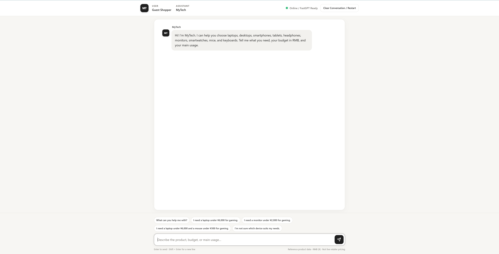
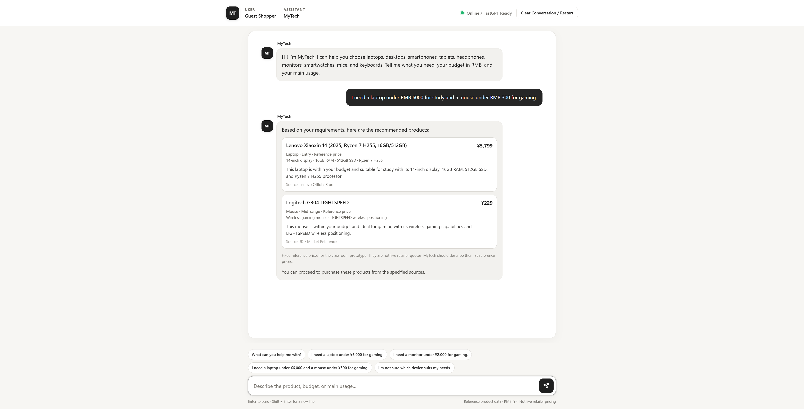

# MyTech v2 — Grounded RAG Product Recommendation Assistant

[](https://github.com/ych680/mytech-ai-assistant/actions/workflows/tests.yml)
[](https://github.com/ych680/mytech-ai-assistant/actions/workflows/ci.yml)

MyTech v2 is an electronic product recommendation chatbot developed as a postgraduate AI coursework team project. Users describe a device, maximum budget, and main usage; the assistant retrieves reference product evidence, asks for missing requirements, and returns validated recommendations rather than relying on unrestricted model output.

The locally runnable prototype combines a **browser frontend**, a **Node.js backend**, and a **FastGPT RAG workflow**. It covers **9 product categories and 27 reference products**, with deterministic response validation. Three independent Python tooling capabilities extend the repository with dataset validation, RAG knowledge preparation, and native LLM tool orchestration. A separate offline Agent Evaluation framework exercises Tool 3 under controlled responses. The repository contains **224 Python tests (90 existing tooling tests plus 134 Agent Evaluation tests) and 16 Node.js tests**; these counts describe automated checks, not real-model accuracy or production reliability.

## Demo

[Watch on YouTube: MyTech v2 | RAG Product Recommendation Chatbot — Project Demo](https://youtu.be/0BjV3ngw40w)

This approximately 67-second demo shows multi-product recommendations, contextual follow-ups, multi-turn clarification, and hard-budget constraints with no-match handling.

### Chatbot Interface

Starter prompts, generation status, conversation restart, and product cards support the recommendation flow.



### Multi-product Recommendation

Each product request keeps its own category, budget, and usage requirements. For example:

> I need a laptop under RMB 6000 for study and a mouse under RMB 300 for gaming.



These screenshots show earlier local demonstrations; they do not capture every current feature. There is no public production deployment.

## Key Features

- **Grounded recommendations:** FastGPT retrieves product evidence from the MyTech knowledge base before recommendation generation.
- **Supported categories:** Laptop, Desktop, Smartphone, Tablet, Headphones, Monitor, Smartwatch, Mouse, and Keyboard.
- **Conversation handling:** Multi-turn clarification, separate requirements for multi-product requests, and contextual cheaper, more expensive, or alternative follow-ups.
- **Hard-budget enforcement:** Deterministic checks reject recommendations above the active maximum budget.
- **Structured responses:** JSON output is validated for product identity, category, exact reference price, source consistency, and response fields before card rendering.
- **Restart and safe errors:** Restart clears local conversation state and rotates the FastGPT `chatId`. Failed requests, timeouts, and unusable model output display an error without unvalidated product cards; invalid workflow recommendations use a fallback branch.
- **Failed request recovery:** “Edit and try again” restores the submitted message to the composer, resizes it, and focuses it for editing. It makes no request and does not alter conversation state. Existing drafts, including whitespace, are protected; another submission or Restart invalidates older recovery actions.

## System Architecture

### Consumer-facing Chatbot

```text
Browser Frontend → Node.js Backend → FastGPT Workflow
                                      ↓
                            State Extraction and Routing
                                      ↓
                            Knowledge Base Retrieval (RAG)
                                      ↓
                            Grounded Recommendation Generation
                                      ↓
                            Workflow Validation and Normalization
                                      ↓
Node.js Response Validation → Browser Validation → Product Card Rendering
```

The browser submits requests to the same-origin `/api/mytech` endpoint. The backend calls FastGPT with server-side credentials and a conversation `chatId`; FastGPT manages workflow conversation variables for follow-ups. Validation is applied at three points, with different responsibilities:

| Layer | Implemented checks |
|---|---|
| FastGPT workflow | Product identity, category and active-request consistency, exact price and source, hard budgets, duplicate categories, and follow-up constraints. |
| Node.js response helpers | JSON parsing and response shape, catalogue identity/category/price, source when supplied, active budgets, recognized usage tags, and selected unsupported live-price/availability claims. |
| Browser | Response shape and catalogue checks, active budget/usage constraints, contextual follow-up checks, and selected unsupported live-price/availability claims before rendering. |

Retrieval supplies evidence; validation checks defined rules against reference data. These checks do not establish that every generated explanation is correct.

The response contract contains `answer`, `recommendations[]`, `next_step`, and `clarification_needed`. See the [workflow documentation](workflow/README.md) for the full pipeline, routing branches, and JSON example.

### Knowledge and Local References

The [knowledge-base source](knowledge/MyTech_Product_Knowledge_v1.md) groups each product's name, category, reference price, usage, features, and source for FastGPT retrieval. The [local JSON catalogue](mytech_v1_product_dataset.json) supplies backend/browser validation data and card details; the workflow also contains a static validation catalogue.

The [system prompt file](mytech_v1_system_prompt.txt) is still loaded during server and browser initialization. Keep it and the JSON catalogue alongside the application files. The published FastGPT workflow contains the model-node prompts used for generation.

### Independent Python Tools and Agent

| Capability | Purpose |
|---|---|
| **Tool 1 — Product Dataset Validator** | [Validates JSON catalogue structure and product fields](tools/validate_products.py), including duplicate identities, prices, categories, and optional strict compatibility with the 27-product classroom catalogue. |
| **Tool 2 — RAG Knowledge Builder and Consistency Checker** | [Generates deterministic Markdown or checks existing knowledge against the dataset](tools/build_knowledge.py). Generation creates a new file without overwriting existing files; checking is read-only. |
| **Tool 3 — Native LLM Tool Orchestrator** | [Coordinates TokenProxy native tool calls](tools/tool3_tokenproxy.py) through an [allowlisted Python executor](tools/tool3_executor.py), then feeds structured tool results back to the model for an explanation. |

Tool 3 operates independently from the consumer-facing chatbot. Its model can request only `validate_products` and `check_knowledge`; it cannot invoke Tool 2's file-generation operation.

```text
Local request → Python orchestrator ↔ TokenProxy LLM (native tool_calls)
                       ↓                         ↑
              Allowlisted executor → Tool-result feedback
                       ↓
              Dataset validation / Knowledge consistency check
```

The bounded loop allows at most three completion attempts, two tool rounds, and eight total tool calls. Structured execution results remain separate from the model's explanation. See [Tool 3 architecture and security](docs/tool3-architecture.md) for the protocol, limits, and opt-in live CLI.

A **manually performed TokenProxy live smoke test**, reported by the maintainer, successfully executed both tools: **27 products in 9 categories validated**, **27 knowledge records consistent**, using **3 API requests and 2 tool rounds**. This verifies that integration for the demonstrated request; it is separate from offline tests and CI, and does not measure general tool-selection or explanation accuracy.

### Offline Agent Evaluation Framework

The [offline evaluation framework](docs/agent-evaluation.md) runs **16 deterministic scripted scenarios** through the actual Tool 3 orchestrator and executor. Each scenario receives isolated temporary resources: **F0** copies the valid baseline, **FD** introduces an invalid dataset field, and **FK** introduces a knowledge-price inconsistency. Source dataset and knowledge files remain unchanged.

The Runner records actual attempts and results. The deterministic Scoring Engine checks required operations, permitted plans, authorization, redundant/unnecessary calls, execution bounds, and final delivery. **Task verdicts** describe simulated agent behavior; **evaluation expectation verdicts** say whether the observed assessment matches the scenario oracle. An intentionally failed task can therefore pass its evaluation expectation. AE-04 and AE-15 remain pending human review; deterministic execution checks do not establish full semantic explanation correctness.

Versioned **JSON and Markdown evidence reports** are generated from the same assessment data, only into an explicitly selected directory, with existing report files preserved. Offline evaluations make **no external LLM calls and consume no school API tokens**. This framework is independent of the consumer chatbot and is not a production deployment or an empirical LLM accuracy benchmark.

See the [evaluation guide](docs/agent-evaluation.md#running-offline-checks) for test commands and [report generation](docs/agent-evaluation.md#generating-evidence-reports) for Windows PowerShell and macOS/Linux commands.

## Testing & CI

The project contains **224 Python tests** using standard-library `unittest`: **90 existing tooling tests** and **134 Agent Evaluation tests**. There are also **16 Node.js tests** using Node.js built-ins, without additional testing packages:

| Suite | Tests | Coverage |
|---|---:|---|
| [Product validator](tests/test_product_tools.py) | 15 | Dataset structure, duplicate JSON keys and identities, finite numbers, prices, dates, strict-v1 rules, and read-only CLI behavior. |
| [Knowledge builder/checker](tests/test_build_knowledge.py) | 12 | Deterministic generation, legacy/generated formats, escaping, field and record drift, read-only checks, and overwrite protection. |
| [Tool 3 executor](tests/test_tool3_executor.py) | 29 | Exact call envelopes, allowlisted resources, batch rejection, validation prerequisites, resource limits, result statuses, and no network/subprocess execution. |
| [Tool 3 TokenProxy orchestration](tests/test_tool3_tokenproxy.py) | 34 | Scripted provider responses with the real executor, native message ordering, multi-round limits, provider failures, bounded diagnostics, and mocked live-CLI acceptance. |
| [Evaluation foundation](tests/test_tool3_evaluation_foundation.py) | 28 | Strict scenario contracts, isolated F0/FD/FK fixtures, controlled defects, resource hashes, integrity and cleanup. |
| [Evaluation Runner](tests/test_tool3_evaluation_runner.py) | 25 | All 16 actual offline execution paths, native call evidence, safe authorization flags, partial results, protocol/infrastructure failures, and no credential or live-provider access. |
| [Evaluation Scoring Engine](tests/test_tool3_evaluation_scoring.py) | 43 | Operation handling, dependency blocks, plan alternatives/order, task versus expectation verdicts, human review, failure categories, and crafted-observation calibration. |
| [Evaluation evidence reporting](tests/test_tool3_evaluation_reporting.py) | 38 | Versioned safe-field projection, JSON/Markdown consistency, derived totals, verified offline transport, explicit temporary output, overwrite refusal and write-failure rollback. |
| [Response tests](tests/response.test.mjs) | 8 | FastGPT message extraction, JSON parsing/error codes, optional-source normalization, field validation, valid no-result/clarification responses, catalogue mismatches, budget boundaries, and recognized usage constraints. |
| [Frontend recovery tests](tests/frontend-recovery.test.mjs) | 8 | Recovery creation, exact submitted-text restoration, resize/focus, no extra request or state changes on restore, draft/generation protection, stale-action invalidation, restart-aborted/late failures, and subsequent submission through validation. |

Run both Node.js suites locally from the repository root; Python commands are in [Python Tooling with uv](#python-tooling-with-uv):

```bash
node --test tests/response.test.mjs tests/frontend-recovery.test.mjs
```

The frontend suite executes the actual inline script in `node:vm`, skipping automatic initialization and using minimal DOM stubs and a fake model adapter. Neither suite requires credentials, a running server, or real FastGPT calls.

[GitHub Actions](https://github.com/ych680/mytech-ai-assistant/actions) provides two workflows, both using Node.js 24:

| Workflow | Triggers | Checks |
|---|---|---|
| [Cross-platform CI](.github/workflows/ci.yml) | Pull requests targeting `main` | All Python and Node.js suites, strict catalogue validation, and knowledge consistency on **Ubuntu, Windows, and macOS**, with Python 3.12 and uv 0.13.0. |
| [Response tests](.github/workflows/tests.yml) | Pull requests and pushes to `main` | Server/response-helper syntax checks and both Node.js suites on Ubuntu. |

The badges and Actions run history show CI results for their associated revisions. The cross-platform workflow currently does not run on pushes to `main`. Its checks are offline with respect to FastGPT and TokenProxy; environment setup may download the runtime/tooling.

The 224 Python tests verify deterministic tooling and scripted/mocked provider behavior, including the live CLI through mocks; they do not measure real-model accuracy. The existing cross-platform Python discovery command automatically includes all 134 evaluation tests, including temporary report generation; no additional workflow or duplicate smoke-test step is needed. The manually verified TokenProxy smoke test above provides separate live integration evidence. Neither the automated suites nor that smoke test establish broad recommendation accuracy, live FastGPT availability, browser layout correctness, or production reliability.

## Python Tooling with uv

All three Python tooling capabilities and the offline evaluation framework use Python 3.12 and the standard library;
no Python packages are needed. The chatbot continues to run on Node.js and FastGPT.

With [uv](https://docs.astral.sh/uv/getting-started/installation/) installed
(verified with uv 0.13.0), run these commands from the repository root on either
Windows PowerShell or macOS Terminal:

```sh
uv sync --locked --managed-python
uv run --locked python -B -m unittest discover -s tests -p "test_*.py" -v
uv run --locked python -B tools/validate_products.py --strict-v1
uv run --locked python -B tools/build_knowledge.py --check knowledge/MyTech_Product_Knowledge_v1.md
```

uv downloads a managed Python if needed and creates or reuses the project-local
`.venv`; activation is unnecessary. `.python-version` selects the 3.12 series,
while `pyproject.toml` excludes Python 3.13 and newer. Patch versions may differ
between machines; `uv.lock` records the project dependency resolution, not an
exact Python interpreter build. `package = false` prevents building or installing
the repository as a Python package. Keep the lockfile with the configuration.

To run tests directly with an existing environment, without syncing it:

```powershell
# Windows PowerShell
.\.venv\Scripts\python.exe -B -m unittest discover -s tests -p "test_*.py" -v
```

```sh
# macOS Terminal
./.venv/bin/python -B -m unittest discover -s tests -p "test_*.py" -v
```

Keep `.venv` local to each machine; do not copy it between operating systems.
It and Python caches remain ignored by Git. `uv sync` normally removes packages
not declared by the project; use `uv sync --locked --managed-python --inexact` if
an existing environment contains extra packages that must be retained.
The tests, validator, and knowledge check above need no API credentials and make no
FastGPT or TokenProxy calls. The knowledge command only checks the existing file;
it does not rebuild it. Initial `uv sync` may require internet access for setup;
the existing-environment commands avoid that synchronization step.

### Optional Tool 3 Live Smoke Test

To deliberately repeat the fixed live integration demonstration after setting up
Python, run from the repository root in a terminal supporting hidden input:

```sh
uv run --locked python -B -m tools.tool3_tokenproxy --live
```

This command calls the real TokenProxy API. It prompts for the API key using hidden
`getpass` input, does not read credentials from files or environment variables, and
does not accept the key as a command-line argument. It exits if secure hidden entry
is unavailable. Without `--live`, the CLI only displays help and makes no API call.
It prints structured results and exits successfully only when orchestration completes
and both named tools have successful execution records. Request/round counts can
vary within the limits; the reported manual run used three requests and two rounds.

## My Contribution

MyTech is a postgraduate team coursework project. As the repository maintainer, I led most of the core implementation: product and workflow design, FastGPT workflow configuration and API integration, frontend/backend integration, testing and troubleshooting, automated tests and GitHub CI improvements, and ongoing repository maintenance. Other team members participated in testing, reproducing workflow configurations, and related project activities.

## Setup and Reproducibility

Prerequisites: Node.js **20.6 or newer** for the documented `--env-file` command, and access to a FastGPT deployment with suitable models and a knowledge base. CI uses Node.js 24. The local application uses Node.js built-ins; no package installation is required.

1. **Import the workflow.** Import [workflow/mytech-fastgpt-workflow.json](workflow/mytech-fastgpt-workflow.json) into your FastGPT deployment.
2. **Select the models.** The export retains these intended model names, but its account-specific `modelId` values are empty:

   | Node | Intended model |
   |---|---|
   | State Extraction | `glm-5.3-flash` |
   | Clarification Assistant | `glm-5.3-flash` |
   | Recommendation Assistant | `deepseek-v4.1-flash` |

   Re-select each model after import. Availability depends on the deployment; if a listed model is unavailable, choose a compatible model and verify workflow behavior in that environment.
3. **Import and bind the knowledge base.** Create a FastGPT knowledge base, import [knowledge/MyTech_Product_Knowledge_v1.md](knowledge/MyTech_Product_Knowledge_v1.md), and bind it to **Knowledge Retrieval**. The export intentionally has no dataset binding; its dataset-description ID is `REPLACE_AFTER_IMPORT`. Save and publish the configured workflow.
4. **Configure the local environment.** From the repository root, copy the placeholder template:

   ```bash
   cp .env.example .env
   ```

   Set `FASTGPT_API_KEY`, `FASTGPT_API_URL`, and `FASTGPT_APP_ID` for your published workflow. `PORT` defaults to `8787`. The backend accepts HTTPS endpoints, or HTTP endpoints on localhost/loopback. The template's example endpoint is not a working deployment.
5. **Run locally:**

   ```bash
   node --env-file=.env mytech_v2_server.mjs
   ```

6. Open [http://127.0.0.1:8787](http://127.0.0.1:8787), or the port configured in `.env`. The server binds to `127.0.0.1`.

The portable export omits API credentials, account-specific model IDs, and concrete knowledge-base IDs. Keep credentials server-side and never commit real environment files. [.gitignore](.gitignore) excludes local `.env` files and backups; [.env.example](.env.example) contains placeholders only.

## Repository Guide

| File or directory | Purpose |
|---|---|
| [MyTech_Chatbot_v2.html](MyTech_Chatbot_v2.html) | Browser UI, local conversation constraints, validation, card rendering, and failed request recovery. |
| [mytech_v2_server.mjs](mytech_v2_server.mjs) | Local HTTP server and server-side FastGPT integration. |
| [mytech_response.mjs](mytech_response.mjs) | Response parsing, normalization, and deterministic validation helpers. |
| [workflow/](workflow/README.md) | Portable workflow export, architecture documentation, and workflow screenshots. |
| [knowledge/MyTech_Product_Knowledge_v1.md](knowledge/MyTech_Product_Knowledge_v1.md) | Knowledge-base import source. |
| [mytech_v1_product_dataset.json](mytech_v1_product_dataset.json) | Local validation catalogue and card data. |
| [mytech_v1_system_prompt.txt](mytech_v1_system_prompt.txt) | Required runtime/reference prompt file. |
| [tools/validate_products.py](tools/validate_products.py), [tools/build_knowledge.py](tools/build_knowledge.py) | Independent product validation and RAG knowledge preparation/checking. |
| [tools/tool3_tokenproxy.py](tools/tool3_tokenproxy.py), [tools/tool3_executor.py](tools/tool3_executor.py) | Native LLM orchestration and allowlisted read-only execution. |
| [docs/tool3-architecture.md](docs/tool3-architecture.md) | Agent architecture, security boundaries, and manual live verification. |
| [evaluations/](evaluations/) | Scripted scenarios, isolated fixtures, offline Runner, deterministic scorer, and versioned evidence reporter. |
| [docs/agent-evaluation.md](docs/agent-evaluation.md) | Offline evaluation architecture, scenario guide, report commands and interpretation, and security/reproducibility boundaries. |
| [tests/](tests/) | 224 Python tests (90 tooling and 134 evaluation) and 16 Node.js tests. |
| [.github/workflows/ci.yml](.github/workflows/ci.yml), [.github/workflows/tests.yml](.github/workflows/tests.yml) | Cross-platform checks and Node.js syntax/test CI. |
| [docs/screenshots/](docs/screenshots/) | Local demonstration screenshots. |

## Prototype Limitations

- Prices are fixed RMB reference values; live retailer pricing, inventory, and purchasing are not supported.
- The classroom catalogue contains only 27 products. Recommendations are limited by that dataset and the configured retrieval/model behavior.
- Running recommendations requires a configured external FastGPT workflow, available models, and the imported knowledge base. The “FastGPT Ready” status checks configuration, not live connectivity.
- Tool 3 requires TokenProxy only for live orchestration and remains separate from the chatbot. Its executor allows two read-only operations; arbitrary shell commands, model-selected paths, and file-writing actions are unsupported. Controlled Knowledge Generation / Phase 3 is not implemented.
- Tool 3's structured statuses are execution evidence; its generated explanation is not independently fact-checked. Real-model task-completion and tool-selection accuracy have not been benchmarked. Local JSON/Markdown consistency checks do not verify the deployed FastGPT knowledge base or the workflow's static catalogue.
- The project is a local coursework/portfolio prototype, with no public production deployment. Public hosting would require authentication, rate limiting, monitoring, and appropriate secret management and operational controls.
