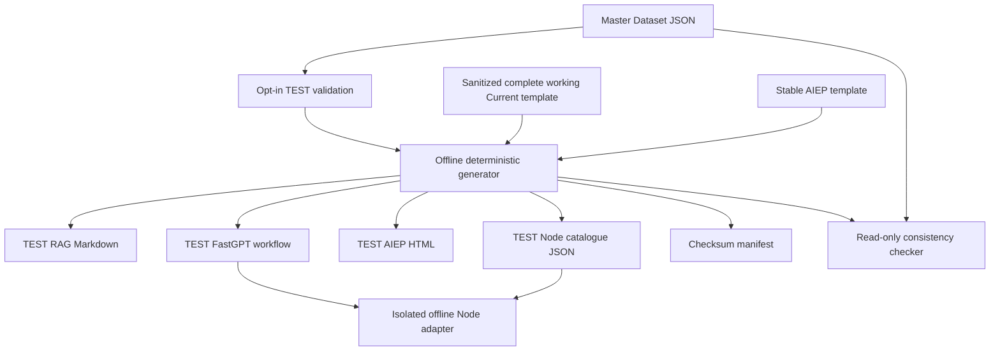

# MyTech v2.1 TEST catalogue synchronization

Latest optimization: [targeted LLM prompt reduction](v21-targeted-llm-latency.md).
The 20-node/18-edge TEST graph and every binding remain unchanged; only State
Extraction and Recommendation instruction text is consolidated into maintained
templates. Histories, RAG evidence, model settings and validation are retained.

Latest workflow change: [State Extraction reliability fix](v21-state-extraction-reliability.md).
TEST now has 20 nodes / 18 edges: one deterministic RMB input stage precedes
the 19-node Current baseline. All original IDs/state bindings and the remaining
16 original connections are preserved. This is the reviewed structural exception
to earlier rebuild/performance reports; the authoritative snapshot is unchanged.

Local implementation only. No app was imported, updated or published. No live
requests, environment-file access, credentials, deployment or Git writes are part
of this pipeline. All 27 new provisional products remain TEST candidates.

The active workflow baseline is now the **complete working Current export**,
stored as a sanitized local template. See [the Current-baseline rebuild report](v21-current-baseline-rebuild.md)
for the structural audit, preserved IDs/bindings and latest file inventory.
See [the performance and local TEST guide](v21-performance-and-local-test.md)
for the current 0.35 parameter overlay, independent server, launch commands,
strict frontend validation and latest verification evidence.

## Audit and architecture

The original dataset contains 27 products across nine categories and remains
unchanged. `--strict-v1` and all original tests retain their behavior.

The existing Python validator already supports variable catalogue sizes. Its
opt-in `--test-v21` adds TEST identity, category-prefixed IDs, JavaScript-safe
positive integer prices, unambiguous names, required review evidence and
preservation of every original baseline product fact. It requires the existing
nine categories in order, without fixing a product count. New entries must use
`NEW CANDIDATE — provisional` or `NEW CANDIDATE — unverified`; they cannot claim
baseline or Current approval. IDs use the category prefix plus 3–9 digits with
a positive numeric suffix.

The existing RAG builder already renders deterministic, escaped Markdown. It
now also preserves review status, evidence URL, price evidence and a per-record
TEST disclosure when review metadata is present. Its exclusive-create CLI and
original v1 output remain compatible.

The stable server still reads the v1 dataset and unchanged response module. It
never imports the TEST adapter. Its configuration and behavior stay unchanged.



All catalogues derive from `catalogue/mytech_products_v2_1_test.json`. Edit that
file, then run `tools/sync_catalogue.py`; never hand-edit generated facts.
Synchronization is an explicit local regeneration step, with no background
watcher or live synchronization. The generator retains dataset order, uses
UTF-8/LF and deterministic JSON serialization, and adds no timestamps. The
manifest hashes the canonical dataset and every generated asset. Repeated
generation leaves identical files and modification times untouched. HTML data
and JavaScript literals escape script-closing characters.

The generated workflow includes a reviewed recommendation validation overlay:
the `PRODUCT_CATALOG` plus TEST-only usage and failure handling. Catalogue
entries carry exact name, price, category, source, usage, ID, specifications and
review metadata. The generator uses
`tools/templates/mytech_current_working_portable.json` as its full structural
template. The validator and State Extraction reliability overlays plus four
reviewed TEST parameter values differ: retrieval similarity 0.35, clarification reasoning disabled,
clarification maxToken 800 and recommendation maxToken 4096. These are stored in
`tools/templates/v21_test_settings.json` and recorded in the manifest.
All original node/output IDs, downstream routing, state bindings, public
response structure and comparison direction checks are preserved. Extraction
has an appended consistency instruction and its content reference now reads
the new normalization node. The guard applies the bounded reliability checks.
State Extraction's base wording and Recommendation's instructions now use
`v21_state_extraction_prompt.txt` and `v21_recommendation_prompt.txt`; the reliability
appendix and all interpolation references remain intact. The prompt-size report
uses transparent character-based estimates, not measured GLM tokens or speedups.
Query content and
comparison-history logic are copied from Current without any serialization or
schema conversion. Its 19 original nodes, system configuration and five global
variables are preserved. The later reliability overlay replaces only the
Start-to-Extraction connection with the two-step normalization path; generated
TEST has 20 nodes and 18 edges. Name the imported application explicitly TEST.

The overlay is maintained in `tools/sync_catalogue.py` and three small templates:
`v21_usage_validation.js`, `v21_usage_compatibility.json` and
`v21_validation_failure.js`. No generated workflow is edited by hand. The
generator refuses changed template markers or malformed usage policies instead
of silently skipping hardening. The stable workflow file remains unchanged.

The AIEP output embeds the complete Master Dataset and derives its expected
identity/count from generation. A small maintained JS template replaces its
v1-specific dataset validator with strict TEST validation. Visible disclosure,
title and browser key-storage name distinguish the TEST page. Existing routing,
conversation handling remains intact. The generated TEST page requires source,
positive hard budgets and deterministic usage compatibility. On loopback it
first checks `/api/test/config`, then uses only `/api/test/mytech` on the separate
TEST server. Hosted school routing still needs an independently configured TEST
proxy binding. Generation/checking make no live requests; local initialization
reads only the local server configuration.

## Commands

Use an existing Python environment; no installation or credentials are needed.
On Windows substitute `.venv\Scripts\python.exe` for `.venv/bin/python`.

```sh
.venv/bin/python -B tools/validate_products.py --strict-v1
.venv/bin/python -B tools/validate_products.py --dataset catalogue/mytech_products_v2_1_test.json --test-v21
.venv/bin/python -B tools/sync_catalogue.py
.venv/bin/python -B tools/sync_catalogue.py --check
.venv/bin/python -B tools/check_catalogue_consistency.py
.venv/bin/python -B -m unittest discover -s tests -p 'test_*.py'
node --test tests/*.test.mjs
```

Both check commands are read-only, returning exit code 1 for missing, modified
or stale files. They compare complete generated bytes, including facts,
metadata, RAG records, non-catalogue workflow code, frontend validation and
manifest hashes. They never repair files or create missing output directories.
Cross-platform CI runs the checker and the new tests alongside the old tests.

For isolated fixtures, pass `--dataset /path/to/master.json --output-root
/path/to/scratch`. Output always goes below `generated/v2_1_test` inside that
root. All assets are validated/rendered before writing; symlink output paths
are rejected. Writes are per-file, so an interrupted generation may leave a
partial set; checking detects this and regeneration repairs it. Template marker
changes require review. Concrete dataset/model bindings or private account
metadata in the workflow template cause generation/checking to fail closed.

## Outputs and Node adapter

| File under `generated/v2_1_test/` | Consumer |
| --- | --- |
| `MyTech_Product_Knowledge_v2_1_TEST.md` | Separate TEST RAG knowledge base |
| `mytech-fastgpt-workflow-v2_1-TEST.json` | Separate TEST FastGPT application |
| `index.html` | Separate AIEP TEST frontend/upload |
| `catalogue.json` | Isolated Node TEST catalogue |
| `manifest.json` | Review provenance and checksums |

`mytech_v2_1_test_adapter.mjs` is an offline library without a listener,
environment access, credentials or network transport. It loads the generated
Node catalogue and executes the generated workflow validator in a bounded VM.
It adds the existing strict Node response validator as a preflight and requires
an exact source. Usage checks for initial and follow-up recommendations now come
from the generated FastGPT validator itself, with no duplicate Node usage
policy. It rejects incomplete requests, malformed response contracts,
invalid identities/categories/prices, budget violations and failed follow-up
comparisons. The stable server does not use this adapter.

```js
import { createTestAdapter } from './mytech_v2_1_test_adapter.mjs';
const adapter = await createTestAdapter();
const result = adapter.validate({
  raw_json: JSON.stringify(modelOutput),
  active_requests: [{ category: 'Mouse', budget: 300, main_usage: 'gaming' }],
  previous_recommendations: [],
  follow_up_intent: 'none'
});
// Render/store only valid results; the workflow result is result.result.
```

## Deterministic usage hardening and remaining limits

The stable source checks usage only for comparison follow-ups. The TEST overlay
closes that gap by checking every recommendation, including `follow_up_intent =
none`, against the matching active request and generated Master Dataset tags.
It validates multiple requests independently and requires every use in a
compound request to be supported. Any rejected item rejects the response batch;
no partial batch is persisted.

The policy accepts every exact usage tag present in the Master Dataset, plus
explicitly maintained aliases such as studying, playing games, coding and
noise-cancelling. It normalizes Unicode compatibility forms, case, hyphens,
whitespace and common punctuation. Longest phrases take priority, so a specific
capability such as `competitive gaming` cannot be reduced to generic `gaming`.
Ordinary wrapper words are allowed, but every remaining word must be covered.
Unknown usages, mixed known/unknown clauses, unknown qualifiers, negation and
ambiguous `or` expressions fail closed with a request to restate the usage.
No recognized substring can hide an unsupported remainder.

The reviewed TEST compatibility policy also removes unsafe broad equivalences:
travel/commute alone does not prove noise cancellation, heavy multitasking does
not prove development support, and social-media use does not prove photography.
Creative includes explicit creative, drawing and content-creation tags; calls
include voice-chat tags. No Master Dataset tags were edited or invented.
Regression tests exercise every product/tag pair on initial and comparison
turns, alongside accepted aliases and deliberately rejected expressions.

All rejection paths now publish an empty recommendation list in a safe
four-field public JSON response and preserve previous recommendations in the
validator result. Current's false branch bypasses the state writer and uses its
existing fallback. The writer's binding stays unchanged; rejected products
cannot overwrite comparison anchors or clear earlier valid recommendations.
Own-property lookups also prevent inherited JavaScript names being treated as
catalogue identities. Product facts, hard budgets and comparison checks remain.

This is a bounded English usage parser, not unrestricted language understanding.
Valid wording outside the reviewed vocabulary requests clarification instead of
guessing. New Master Dataset tags are recognized automatically; additional
aliases need review. Empty no-result responses contain no recommendation to
approve and retain existing no-result behavior. Additional categories still
require extraction/routing/frontend changes. The TEST AIEP page retains its
existing client-side vocabulary; the hardened backend is authoritative.

The baseline FastGPT validator also normalizes some malformed fields and
coerces price strings to numbers; this behavior is preserved. The TEST Node
preflight and AIEP enforce strict public response types. Source requirements
also differ: FastGPT and the TEST adapter require an exact source; the unchanged
AIEP v1 response contract permits omission. The generated TEST frontend now
requires an exact source too; null/omitted/mismatched sources are rejected.
All generated product records retain the exact source.

No external evidence URLs, SKU accuracy, availability or market prices were
verified. The new products remain provisional/unverified; this work does not
promote any candidates to Current or production.

## Manual FastGPT integration after review

1. Generate/check locally and review candidate evidence, checksums and the
   deterministic usage policy above.
2. Create a **separate v2.1 TEST knowledge base** and import the generated TEST
   Markdown. Replace old TEST chunks on regeneration so stale facts do not
   remain retrievable. Never replace the Current knowledge base with candidates.
3. Create a **separate v2.1 TEST FastGPT application**. Import the generated
   TEST workflow, re-select compatible models and bind Knowledge Retrieval to
   the new TEST knowledge base in the account UI. Portable files retain
   `datasets: []`, `REPLACE_AFTER_IMPORT` and empty native `model` selections. Never save
   concrete account bindings back into portable templates or generated exports.
4. Confirm IDs, edges, state variables and response fields after import. Run
   initial, multi-category, cheaper, more-expensive, alternative, no-result,
   invalid-output, unknown-usage and budget-boundary scenarios. Confirm invalid
   responses preserve earlier recommendation memory in the deployed runtime.
5. If later authorized, connect only the separate TEST frontend to the separate
   TEST app. For hosted AIEP verify the server-side proxy is TEST-specific before
   submitting anything. A filename or local key-storage name cannot isolate a
   hosted proxy's application binding.
6. On every Master Dataset change, regenerate locally and refresh both TEST
   knowledge and workflow together. Local checking cannot verify remote state.

No integration step has been performed by this implementation.

## Offline test evidence and limitations

The following counts describe earlier implementation stages. The latest
Current-baseline rebuild evidence is in the linked rebuild report above.

Final safety hardening: **240 Python tests and 230 Node tests passed**, with no
failures or skips. The 35 new Node regression cases include all 159 current
product/usage-tag pairs on initial, directional comparison and alternative turns,
accepted natural-language variants, unknown and mixed expressions, multiple
requests and actual exported state-writer/public-response bindings. The extra
Python regression rejects malformed TEST usage policies before generation.
Generated-output consistency, strict-v1 validation, v1 knowledge consistency,
v2.1 TEST validation, adapter syntax and whitespace checks passed. Checksums
confirmed all stable source assets and the supplied Master Dataset unchanged.
Only the recommendation validation node differs; edges and conversation config
match the stable graph.

The synchronization baseline passed **239 Python tests and 195 Node tests**, with no
failures or skips. Strict-v1 validation, v1 knowledge consistency, v2.1 TEST
validation, generated-output consistency, adapter syntax and whitespace checks
passed. Checksums confirmed the original dataset, workflow, AIEP page, server,
response module, v1 knowledge, stable HTML and supplied Master Dataset unchanged.

The audit baseline passed 226 Python and 175 Node tests. New Python tests cover
all generated fields, graph equality, deterministic/idempotent generation,
read-only checks, invalid IDs/duplicate names, missing fields, incorrect/unsafe
prices, baseline preservation, portable bindings, script embedding and symlinks.
New Node tests execute the generated workflow validator and actual frontend,
all 54 products, strict contracts, exact hard budgets, initial usage, comparison
direction/anchors and the initial-usage hardening.

The 55th-product tests edit temporary Master Dataset copies and regenerate all
assets. They compare every catalogue and RAG record, then execute the expanded
workflow, Node adapter and AIEP initialization/submission path. The real Master
Dataset stays at 54 products. No test needs credentials or live model responses.

Offline tests cannot establish FastGPT import/runtime compatibility, live model
behavior, retrieval quality, chunking, account permissions, hosted proxy binding
or real-browser visual behavior. Frontend execution uses a minimal mock DOM;
workflow execution uses Node's VM with model/retrieval fixtures.

## File inventory

Modified: `tools/validate_products.py`, `tools/build_knowledge.py`, `README.md`
and `.github/workflows/ci.yml`.

New implementation files: `tools/sync_catalogue.py`,
`tools/check_catalogue_consistency.py`,
`tools/templates/v21_dataset_validation.js`, `mytech_v2_1_test_adapter.mjs`,
`tests/test_catalogue_sync.py`, `tests/catalogue-v21.test.mjs` and this guide.
The five new generated files are listed in the outputs table above.

The supplied `catalogue/mytech_products_v2_1_test.json` was already untracked
before implementation and remains unchanged. Original v1 regression tests were
not edited.

Final safety hardening adds the three policy/failure templates above and
`tests/workflow-usage-v21.test.mjs`; updates the generator, offline Node adapter,
v2.1 tests, CI command and this guide; and regenerates the TEST workflow and its
manifest. Stable-v1 tests and source assets remain unchanged.

Exact hardening file changes:

- Modified: `tools/sync_catalogue.py`, `mytech_v2_1_test_adapter.mjs`,
  `tests/catalogue-v21.test.mjs`, `tests/test_catalogue_sync.py`,
  `.github/workflows/ci.yml`, `docs/v21-catalogue-sync.md`.
- Added: `tools/templates/v21_usage_validation.js`,
  `tools/templates/v21_usage_compatibility.json`,
  `tools/templates/v21_validation_failure.js`,
  `tests/workflow-usage-v21.test.mjs`.
- Regenerated with changed bytes:
  `generated/v2_1_test/mytech-fastgpt-workflow-v2_1-TEST.json` and
  `generated/v2_1_test/manifest.json`. Other generated assets remain identical.

## Historical retrieval import repair (superseded by full Current baseline)

This section records the earlier targeted repair. Its per-node compatibility
profile and conversion were removed by the full Current-baseline rebuild; it
does not describe the current generator architecture.

The initial read-only comparison of the repository source and TEST export found
the Knowledge Retrieval node (`tagxGUFuwllhR19r`) identical in every field.
Neither the catalogue generator nor its safety overlay had introduced a retrieval
input, changed its version or altered a node/output ID or reference. The source
already uses this schema in the earlier sanitized repository revisions examined.

The unchanged repository source declares node version `4.17.0` with a required
`datasetSearchInput` of type `arrayString`, selected as `reference`, whose value
is `[["evMBfmr3j2paOLIN", "qLUQfhG0ILRX"]]`. That resolves to Query Builder's
`retrieval_queries` output (`arrayString`). Its UI label is
`workflow:search_query`; there is no input whose key is `search_query` and no
`userChatInput` input on this retrieval node. Query Builder itself still receives
`user_question` from Workflow Start's `userChatInput` output. These distinctions
matter: a UI label is not a native input key, and an output key is not its ID.

The supplied `MyTech_Current_Working_Export_Reference.json` was subsequently
read at the user-provided Downloads path. It contains 19 nodes (including the
system configuration node) and 17 edges, with different application-local node
IDs. Its retrieval node `zWAw4oYVL1QMe8YX` has node version `4.9.2` and a required
`userChatInput` string input, referencing `["sxwN5Fd17Tc8leTf", "qLUQfhG0ILRX"]`.
That output is the string `retrieval_query`. The reference Query Builder joins
multiple queries with newlines. These facts establish a native contract
difference, not a generator-created dangling reference. Individual node versions
do **not** establish the school FastGPT server version.

The TEST generator now uses a sanitized retrieval-only profile derived from that
working export: `tools/templates/v21_fastgpt_retrieval_compatibility.json`.
It reproduces the native 14-input schema and node version, including
`userChatInput`, the legacy model parameter names and collection metadata filter
schema. It omits `datasetSearchInput`, agent-generation input metadata and newer
filter-version fields. Dataset bindings remain empty with the portable
placeholder; disabled rerank/extension model selections remain empty. It copies
neither the reference application's node IDs nor its account bindings.

The TEST retrieval node keeps ID `tagxGUFuwllhR19r`; its user-question input now
references `["evMBfmr3j2paOLIN", "qLUQfhG0ILRX"]`. The existing output ID
`qLUQfhG0ILRX` becomes the native `retrieval_query` string. Query Builder emits
the same query content as before, joined by newlines, and retains identical
comparison history. No context, budget, usage or previous-product text is lost.
All other query inputs, outputs and reference IDs remain unchanged. The system
configuration node and other nodes from the reference are not copied.

This aligns the export with the schema proven by the working Current export and
addresses the absent native required user-question input. The UI's additional
`search_query` field is consistent with recognition of a different schema, but
whether import automatically migrated/augmented the node cannot be confirmed:
there is no post-import TEST export. The failed import existed only as unsaved
Current-editor changes, and no save or online inspection was performed to
obtain one. Runtime acceptance still needs a later isolated TEST import.

The generator now checks required input bindings and referenced output/global
IDs/types, rejects duplicate node/output IDs and input keys, and enforces whole
graph preservation outside the reviewed validator/retrieval-interface overlays.
This validation runs during both generation and read-only consistency checking.
`tests/test_workflow_import_contract.py` covers the native retrieval schema,
required inputs, query-builder references, missing/broken/type-incompatible
references, duplicate identifiers and extra required fields, including bound
extra fields. It also verifies generator execution cannot bypass the guard.

Expected portable/runtime exceptions are explicit: Knowledge Retrieval's empty
`datasets` selection requires account binding, the empty required extraction
`modelId` requires model selection, and Workflow Start's user input is supplied
at runtime. There are no other missing required inputs in either local export.
These local checks prove reference preservation and resolution; they cannot
prove that a different FastGPT release accepts the exported schema.

After this compatibility fix, **251 Python tests and 231 Node tests passed**,
with no failures or skips. Both consistency-check commands, strict-v1 validation,
v2.1 TEST validation, v1 knowledge consistency and whitespace checks passed.
The actual supplied reference was compared locally with the sanitized profile;
all native retrieval field metadata matches, apart from the intentional portable
binding/default redactions. The original reference and all stable assets retain
their pre-audit checksums. Regeneration changes only the TEST workflow and
manifest; the TEST HTML, catalogue JSON and RAG Markdown remain identical.

Exact files for this import-compatibility fix:

- Modified: `tools/sync_catalogue.py`, `tests/test_catalogue_sync.py`,
  `tests/catalogue-v21.test.mjs`, `docs/v21-catalogue-sync.md`.
- Added: `tools/templates/v21_fastgpt_retrieval_compatibility.json`,
  `tests/test_workflow_import_contract.py` (11 Python regression tests).
- Regenerated: `generated/v2_1_test/mytech-fastgpt-workflow-v2_1-TEST.json`,
  `generated/v2_1_test/manifest.json`.

No deployed application, Current editor state, credential, reference export,
stable-v1 file or Git history was modified. The next integration check must use
an isolated TEST application after review; it was not attempted here.
